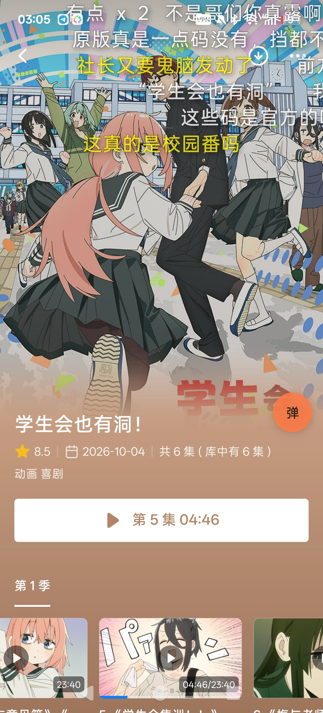
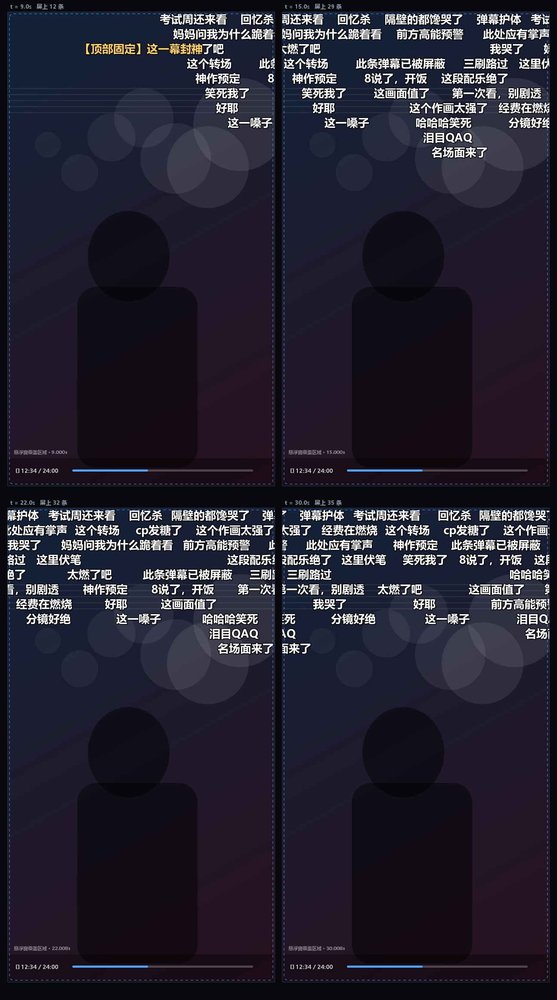

# 弹幕伴侣 · 安卓版

给**任意安卓播放器**叠加弹幕的悬浮窗工具：**需要你先自配弹幕库/服务**，然后自动识别片名和集数、匹配弹幕、跟随播放进度。

这是基于 [爆米花弹幕伴侣（Windows 版）](https://github.com/ghjkllasdf-fake/Baomihua-danmu-companion) 思路的安卓实现。
桌面版给网易爆米花播放器叠一层弹幕窗口；安卓版做同一件事，只不过目标是**任意播放器**——
因为手机上「正在播什么、播到第几秒」可以从系统媒体会话里读出来，不再需要探测播放器窗口。

> **使用前必须自配弹幕库。** 本应用只负责识别和渲染，不内置弹幕源，也不内置官方凭证。
> 先自建 [danmu_api](https://github.com/huangxd-/danmu_api) 并把服务地址填进应用，或到
> [弹弹play开发者中心](https://dev.dandanplay.com) 申请 AppId / AppSecret 接入官方 API。
> 没有配置时悬浮窗能打开，但屏幕上不会出现弹幕。详见
> [弹幕服务配置](#弹幕服务必须配)。



*真机截图：弹幕来自自配的弹弹play v2 服务，叠在播放器画面上；右侧橙色「弹」字圆点是悬浮球。*

[](https://github.com/km191/baomihua-danmaku-android/releases/latest)
[](LICENSE)
[](#安装)
[](https://github.com/km191/baomihua-danmaku-android/releases/latest)

**[下载最新 APK](https://github.com/km191/baomihua-danmaku-android/releases/latest)**（121 KB，已签名，Android 6.0+）

**当前版本：v1.35** · [更新记录](CHANGELOG.md) · [OPPO 适配说明](docs/OPPO-COLOROS.md) · [弹弹play API 接入](docs/DANDANPLAY-API.md)

---

## 它做什么

- **自动找弹幕**：读播放器的标题和副标题，识别片名 / 季 / 集，搜索并挑选分集，加载弹幕。
- **跟随播放**：每 400ms 采一次媒体会话，两帧之间按播放速度外推；播放、暂停、拖进度都跟得上。
- **退出就收起**：媒体会话消失 2.5 秒后自动隐藏，播放器报停止立刻收，暂停超过 20 秒也收；
  重新播放自动接上——不会在桌面或详情页继续滚。
- **悬浮球 + 小面板**：播放时常驻一个「弹」字圆点。单击就地弹出小面板，改字号、换源、校准都不用退出播放。
- **排布可控**：弹幕行数 `1`–`30`（默认 12），从屏幕最顶部往下排；悬浮球默认靠右，可拖动或一键复位。
- **识别不准有兜底**：手动搜索换源、载入本地弹幕文件（XML / 弹弹play JSON）、手动校准时间。
- **换集沿用来源**：同一部剧同一季记住上次选的来源，换集直接按集数取，不用重新搜。
- **官方 v2 鉴权**：自建 danmu_api 免鉴权；官方 api.dandanplay.net 支持签名 / 凭证两种 AppId 鉴权。
- **滑动更顺**：媒体会话采样在独立线程；弹幕时钟本地外推，只有真正拖进度条才清屏重排。
- **隐藏与通知栏开关**：主面板、悬浮球小面板、下拉通知栏都能显示 / 隐藏，不用停止服务。
- **过滤**：屏蔽关键词、合并重复弹幕、时间偏移。

## 最近更新

- **v1.35**：悬浮球右侧留 14dp，避免曲面屏/圆角裁切。
- **1.3.4**：弹幕真正贴顶；横屏后悬浮球重新按比例贴右。
- **1.3.3**：弹幕行数 1–30 可调；悬浮球默认靠右。
- **1.3.2**：主按钮改为隐藏/显示；通知栏点一下切换；「停止服务」才真正结束。
- **1.3.1**：媒体会话轮询移到后台线程，时间轴平滑，减少清屏重排。
- **1.3.0**：官方弹弹play API v2 签名 / 凭证鉴权；AppSecret 用 Android Keystore 加密。

完整变更见 [CHANGELOG.md](CHANGELOG.md)。

## 它不做什么

- 不提供影视资源，只负责把弹幕画在屏幕上；
- 不内置弹幕源，也不内置任何官方 AppId/AppSecret：弹幕来自**你自己填写的**弹弹play API v2 兼容服务；
- 不读取通知内容：「通知使用权」只用于调用 `MediaSessionManager.getActiveSessions()` 拿播放状态。

## 兼容性

- **Android 6.0+（API 23）**，目标 Android 14（API 34），arm64 / armeabi 均可。
- **OPPO / 一加 / realme**：ColorOS 12–15、realme UI 有专用后台设置卡片与保活策略。
- **播放器**：需要注册系统媒体会话（锁屏控制就是这么来的）；极少数自研播放器或网页内嵌 `<video>`
  没有会话时，可以用「校准」起一个本地时钟顶着用。
- **弹幕源**：弹弹play API v2 兼容服务（自建 danmu_api 或官方 api.dandanplay.net）；
  也可以完全离线载入本地 XML / JSON。

## 安装

1. 从 [Releases](https://github.com/km191/baomihua-danmaku-android/releases/latest) 下载 `DanmuCompanion-*.apk`。
2. 传到手机安装（允许「安装未知来源应用」）。用的是本地自签名证书，系统可能提示未知开发者。

## 第一次使用

1. 打开 App，按提示给基础权限：
   - **悬浮窗权限**（显示在其他应用上层）——弹幕要画在别的 app 上；
   - **通知使用权**——读播放器标题与进度，安卓上唯一不需要 root 的正路；
   - **通知权限**（Android 13+）——前台服务需要一条常驻通知。
   OPPO / 一加 / realme 还会多一步 **后台运行（电池优化）**，见下一节。
2. 在「更多设置 → 弹幕服务地址」填入你的弹幕服务，点「测试连接」。
3. 点「开启悬浮窗」：画面上会先闪一条「悬浮窗已开启 · 等待识别片名」，看到它就说明叠加成功。
4. 用任意播放器看视频，几秒后弹幕会自己出现。

## OPPO / ColorOS 用户

ColorOS 的后台管控比原生 Android 严，权限入口也更分散。1.2.0 起应用会识别 OPPO、一加和 realme，
在「自检」下面多出一张 **「ColorOS 后台设置」** 卡片，一键跳到：

- **电池优化** → 允许后台活动（不然锁屏几分钟后弹幕可能消失）
- **自启动** → 允许（重启手机后自动恢复）
- **耗电管理** → 选「允许后台活动」，别选「智能省电」
- **后台弹出界面** → 允许（否则点悬浮球弹不出小面板）

首次开启悬浮窗时如果还没放行电池优化，应用会弹一次提示，点「去放行」即可。
弹幕区域已按挖孔屏和全面屏手势条的安全区排版，横屏时会避开侧边导航栏；
悬浮球默认离屏幕边缘 14dp，不会被 ColorOS 的手势返回区吃掉。

更细的路径（ColorOS 12 / 13 / 14 / 15、realme UI、一加）见
**[OPPO / ColorOS 适配说明](docs/OPPO-COLOROS.md)**。

## 弹幕服务（必须配）

本应用不内置弹幕源，只做「识别 + 渲染」。支持两类弹弹play v2 服务：

### 自建 danmu_api（无鉴权，最简单）

在「更多设置 → 弹幕服务地址」填入服务根地址：

```
https://danmu.example.com
http://192.168.1.10:9321
https://danmu.example.com/YOUR_TOKEN
https://danmu.example.com?token=YOUR_TOKEN
```

程序会自动补 `/api/v2`；路径 Token 和查询参数 Token 都支持。
部署方法见 [danmu_api](https://github.com/huangxd-/danmu_api)。

### 官方 api.dandanplay.net（需要 AppId / AppSecret）

先到 [弹弹play开发者中心](https://dev.dandanplay.com) 申请应用，然后把地址填
`https://api.dandanplay.net`，在「官方 API 鉴权」里选 **签名** 或 **凭证**，
填 AppId / AppSecret 并点「保存鉴权」。

- **签名**（推荐）：Secret 不上网络，请求只带 `X-AppId`、`X-Timestamp`、`X-Signature`。
- **凭证**：请求头带 `X-AppSecret`，只建议在可信网络中使用。
- AppSecret 用 Android Keystore 加密保存在本机；应用不内置任何官方凭证。

完整签名算法、端点与错误码见 **[弹弹play API v2 接入说明](docs/DANDANPLAY-API.md)**。

没有服务也能用：把弹幕 XML（B 站 / 弹弹play 格式）或弹弹play JSON 放进手机，
用「载入本地弹幕」离线加载。

## 悬浮球与小面板

屏幕边上那个橙色「弹」字圆点不是装饰：

| 手势 | 作用 |
|---|---|
| **单击** | 就地弹出 **小面板**：播放器继续播、弹幕继续动，调参能当场见效 |
| **长按** | 打开完整设置页（权限、API 地址、屏蔽词、清缓存） |
| **拖动** | 换位置，松手后记住 |

小面板里有：弹幕行数、字号、速度、不透明度、描边、阴影、时间偏移、密度、等比缩放、底部弹幕，
以及 **重新匹配 / 手动搜索 / 校准** 三个动作。点面板外面自动收起，那一记触摸同时透传给下面的播放器。

小面板是悬浮窗口而不是 Activity，所以它浮在播放器上面；只有打开完整设置页时，弹幕和悬浮球才临时让位。
小面板底部的「隐藏悬浮窗」也只隐藏，不停止服务。
悬浮球默认停在屏幕右侧（留 14dp 边距）；拖到别处后，可在「更多设置」点「悬浮球复位到右边」。

## 隐藏与通知栏开关

不需要「停止悬浮窗」也能暂时收起弹幕：

- 主面板按钮在运行中显示 **「隐藏悬浮窗」**，再点变 **「显示悬浮窗」**；
- 下拉通知栏，点通知本体，或点 **「隐藏悬浮窗 / 显示悬浮窗」** 动作，直接切换；
- 通知里的 **「设置」** 打开完整面板，**「停止服务」** 才会真正结束并移除通知；
- 隐藏状态会记住：开机或服务被系统拉回后保持隐藏，从主面板主动开启时强制显示。

服务保持运行，所以再显示时不用重新识别片名、等网络和重新加载弹幕。

## 自动搜索怎么挑片名

播放器给的标题常常是一整串：`【喵萌奶茶屋】★10月新番★[药屋少女的呢喃][05][1080p][简日双语]`。
**不会把这串东西直接丢给搜索接口**，而是先提炼：

1. 去掉括号里的字幕组、分辨率、语言、编码标签；
2. 去掉季集信息（`第二季`、`第05集`、`S02E05`、`更新至 12集`…），记下季数和集数；
   **集数标记之后的内容一律当分集副标题丢掉**——例如播放器给的
   `学生会也有洞！ 第 3 集 《太好了呢》《泳池大扫除的泳装回！》`，片名只取到 `学生会也有洞！`；
3. 逐段丢掉噪声词（`新番`、`合集`、`简日`、`OVA`…），去掉首尾标点，得到**关键标题**：`学生会也有洞`。

搜索时按 `关键标题 → 带副标题的片名 → 去空格写法` 顺序尝试，**最多三轮，命中即停**：

- 第一轮命中且打分 ≥ 0.45 → 直接加载；
- 没搜到或分太低 → 换下一个关键词；
- 三轮都不行 → 明确提示「匹配度太低」，把决定权交给你。

每一轮候选都要过季数/集数校验，所以「第 2 季」不会因为第 1 季弹幕更多而被选走。

## 设置项

| 设置 | 作用 |
|---|---|
| 显示弹幕 | 总开关，关掉后弹幕仍跟随但不上屏 |
| 弹幕行数 | `1`–`30` 行，从屏幕顶部往下排；默认 12 行，屏幕放不下时自动取最大可用行数 |
| 字号 / 速度 / 不透明度 / 描边 / 阴影 | 拖动实时生效 |
| 等比缩放 | 字号随窗口大小缩放 |
| 弹幕密度 | 稀疏（≤24 条同屏）/ 标准（≤64）/ 密集（≤140） |
| 底部弹幕 | 显示在最后一行；打开开关即可 |
| 屏蔽关键词 | 逗号或换行分隔，重新加载弹幕后生效 |
| 合并重复弹幕 | 同一句话 8 秒内重复只显示一次，标 `×N` |
| 时间偏移 | 正数让弹幕晚出现，范围 ±10 秒 |
| 悬浮球 / 开机自启 | 常驻方式；关闭一次后会记住，下次打开 App 自动恢复 |

## 和 Windows 版的对应关系

| Windows 版 | 安卓版 | 说明 |
|---|---|---|
| 系统托盘常驻 | 前台服务 + 常驻通知 | 另有一个可拖动的悬浮球 |
| 覆盖在播放器上的弹幕窗口 | `TYPE_APPLICATION_OVERLAY` 悬浮窗 | 不可触摸，不影响操作播放器 |
| 窗口探测 / `PlayerSampler` | `MediaSessionManager` 媒体会话 | 需要「通知使用权」才能读别的 app 的会话 |
| 识别片名、季、集 | `TitleParser` | 同一套规则：`第二季`、`S02E05`、`第5话`、`[05]`、`EP05`… |
| 自动匹配 + 多季分别绑定 | `AutoMatcher` + `MatchScorer` + `Prefs.Binding` | 关键标题多轮搜索，季数不符扣分，换集沿用来源 |
| 弹弹play API v2（含 includeAPI） | 同一个 API 契约，地址可填 | 安卓端没有内置 Node 服务，需要你自己的服务地址 |
| 原生弹幕渲染器 | `DanmakuEngine` + `DanmakuView` | 轨迹分配、密度、合并重复、时间偏移 |
| `preferences.json` | 设置 JSON（SharedPreferences） | 字段一一对应 |

## 已知限制

- **播放器必须有媒体会话**。绝大多数播放器播放时都会注册（锁屏控制就是这么来的），
  但少数自研播放器、网页内嵌 `<video>`、部分投屏场景可能没有。没有会话时可以用「校准」起一个本地时钟顶着。
- 部分国产 ROM 需要额外给「后台弹出界面 / 自启动 / 后台运行」，否则系统会静默丢弃叠加窗口。
  OPPO / 一加 / realme 见 [ColorOS 适配说明](docs/OPPO-COLOROS.md)。
- ColorOS 的「应用速冻」「智能省电」可能在锁屏后冻结应用：1.2.0 会引导放行并做闹钟/看护任务恢复，
  但系统级冻结只有电池白名单能彻底避免。
- 弹幕在悬浮窗上不可触摸，所有触摸都透传给播放器。

## 构建

只需要 Android SDK（build-tools 34、platform android-34）和 JDK 17+，**不需要 Gradle，也不需要联网**：

```powershell
powershell -ExecutionPolicy Bypass -File scripts/build.ps1
# 产物：dist/DanmuCompanion-<版本>.apk
```

脚本依次做：`aapt2 compile/link` → `javac` → 清理 `MethodParameters` → `d8` → `zipalign` → `apksigner`。

两个坑记录在这里，方便换机器时排错：

1. **d8 崩溃**：build-tools 34.0.0 的 d8 在解析 javac 21 生成的
   「匿名内部类构造器 + 无名字的 MethodParameters」时会 `NullPointerException`。
   `tools/StripMethodParameters.java` 在转 dex 前把这个可选调试属性删掉，问题消失。
2. **脚本编码**：`.ps1` 用 UTF-8 **带 BOM** 保存，否则 Windows PowerShell 5.1 会按 GBK 读，中文注释会破坏语法。

没有提供 Gradle 工程是有意的：AGP 8 要求把 `package` 从清单移到 `namespace`，
而 `aapt2` 直接构建必须靠清单里的 `package` 定包名，两套构建系统容易漂移。
要在 Android Studio 里开发，把 `app/src/main/AndroidManifest.xml` 的 `package` 挪到 `namespace`、
再补一个最小 `app/build.gradle.kts` 即可——源码本身零第三方依赖。

## 测试

```powershell
powershell -ExecutionPolicy Bypass -File scripts/test.ps1
```

- `tools/CoreTests.java`：**190 项**断言，覆盖片名/季/集解析、关键标题提炼、多轮搜索、多季匹配打分、
  弹幕 JSON/XML 解析、设置序列化与钳制、轨道不重叠、跳转重同步、合并重复、时间偏移、
  「退出播放后收起」的状态门控、API 错误映射、OPPO/一加/realme 识别与挖孔屏安全区计算，
  以及官方 v2 签名向量、鉴权请求头、查询参数 Token 和 403 错误头翻译。
- `tools/HttpEndToEndTest.java`：起一个本地 HTTP 服务扮演弹幕 API，走真实的
  `HttpURLConnection` + gzip + JSON，验证搜索 → 打分 → 取弹幕整条链路。
- `tools/PreviewRender.java`：用 AWT 把引擎渲染成 PNG（下图的来源）。
- `tools/ApiLevelCheck.java`：解析 `classes.dex` 里的方法/字段/父类引用，逐个和 SDK 的
  `api-versions.xml` 对照，确认没有超出 minSdk(23) 的 API——没有真机时这是查
  `NoSuchMethodError` 最直接的办法（它抓出过 `Character.UnicodeScript` 需要 API 24）。



*上图由真实引擎逐帧渲染：四帧分别是 9s / 15s / 22s / 30s，同一轨道内不重叠、不追尾，顶部固定弹幕居中。*

## 目录

```
app/src/main/
  AndroidManifest.xml
  java/com/baomihua/danmaku/
    core/                 纯 Java，可在 JVM 上直接跑
      TitleParser.java      片名/季/集识别、关键标题提炼
      AutoMatcher.java      关键标题 → 多轮搜索 → 可信度判断
      MatchScorer.java      候选打分（多季约束）
      DanmakuEngine.java    轨迹分配、密度、合并、偏移
      PlaybackGate.java     退出播放后该不该显示弹幕
      CommentParser.java    XML / 弹弹play JSON
      DanmuApi.java         弹弹play v2 客户端（官方签名/凭证鉴权）
      Base64Codec.java      官方签名用的 Base64
      UrlHttp.java          HttpURLConnection（gzip）
      Settings.java / MiniJson.java
      OemProfile.java       OPPO / 一加 / realme 识别
      RegionMath.java       挖孔屏与手势条安全区
    OverlayService.java   悬浮窗 + 前台服务 + 流程编排
    FloatingPanel.java    点悬浮球弹出的随身小面板
    DanmakuView.java      Canvas 渲染（描边/阴影/提示条）
    PlaybackTracker.java  媒体会话采样与位置外推
    MediaWatcher.java     通知使用权（只为拿到媒体会话）
    DanmuRepository.java  绑定 → 搜索 → 打分 → 取弹幕 → 缓存
    PanelActivity.java    完整设置页 + 自检 + ColorOS 卡片 + 鉴权设置
    OemSettings.java      ColorOS 设置页跳转与电池白名单
    RestartReceiver.java  划掉任务后的闹钟恢复
    RestartJobService.java 15 分钟后台看护
    SecretStore.java      AppSecret 的 Keystore 加密存储
    Diag.java / Ui.java / Theme.java / Status.java / Prefs.java
  res/                    图标、颜色、主题
scripts/                  构建与测试脚本
tools/                    JVM 测试与静态检查
docs/                     截图、渲染示例、OPPO 与 API 接入说明
```

## 悬浮窗没出来时先看这里

应用里有张 **「自检」** 卡片，列出：机型、系统（ColorOS 版本）、悬浮窗权限、通知使用权、前台服务、
**弹幕窗是否已挂载**、屏幕与安全区、媒体会话、已加载/屏上弹幕数、最近 5 条运行事件与上次崩溃堆栈。

配合三个按钮：**测试横幅**（回桌面后画面中间出现橙色「悬浮窗在这 ✓」，看得到＝叠加没问题）、
**重新挂载**、**复制诊断**（把机型系统版本和上述信息复制到剪贴板）。

常见原因：

| 现象 | 处理 |
|---|---|
| 开启后画面上什么都没出现 | 看「自检」弹幕窗是否「已挂载」，点「测试横幅」验证；看不到就检查「显示在其他应用上层」和厂商的「后台弹出界面」 |
| 提示「前台服务启动失败」 | 系统限制后台前台服务；允许「自启动」「后台运行」再试 |
| 弹幕看几分钟后消失 | ColorOS 电池优化没放行；到「ColorOS 后台设置 → 电池优化」放行 |
| 重启手机后没有自动恢复 | 检查「自启动」是否允许；没允许时打开一次应用也会恢复上次状态 |
| 点悬浮球没反应 / 小面板弹不出 | 到「ColorOS 后台设置 → 后台弹出界面」允许 |
| 「通知使用权」里找不到本应用或开关是灰的 | Android 13+ 的「受限设置」：应用信息 → 右上角「⋮」→ 允许受限设置，再回去授权 |
| 弹幕停住不消失 | 播放器会话还挂在暂停状态，等 20 秒会自动收；一直不收就发诊断信息 |
| 「没能匹配到弹幕」 | 用「手动搜索」换关键词；或先填好服务地址 |
| 有弹幕但看不到 | 检查「显示弹幕」开关、弹幕行数，以及视频是否被别的窗口盖住 |
| 弹幕比画面早/晚 | 用小面板的「校准」输入当前画面时间，或调「时间偏移」 |

## 隐私

- 只有填写了服务地址才会联网，请求发往**你自己填的服务**。
- 不收集统计、不上传设备信息；弹幕缓存只存在应用私有目录。
- 「通知使用权」只用于读取媒体会话状态，不读通知内容、不上传。

## 许可与致谢

本仓库代码为 MIT。桌面版原项目 [Baomihua-danmu-companion](https://github.com/ghjkllasdf-fake/Baomihua-danmu-companion)
同样是 MIT；本仓库是独立实现，只借鉴了产品思路与接口约定，未复制其源码。

弹幕数据来自你所配置的服务；弹幕内容版权归各自作者。
文档截图中的影片画面版权归原权利方，仅作功能演示。
